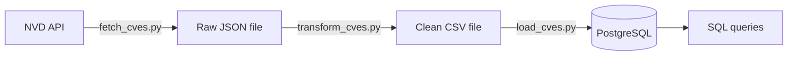

# Vulnerability Intelligence Pipeline

A Python data pipeline that pulls the last week of publicly reported software vulnerabilities (CVEs) from NIST's National Vulnerability Database, cleans them up, and loads them into PostgreSQL so they can be ranked and searched by severity.

I built this to learn how data pipelines work by building one end to end, and to show that work to employers in cloud, data, and security roles.

## How it works



The pipeline has three steps, and `run_pipeline.py` runs them in order with one command.

1. **Extract** (`src/fetch_cves.py`): asks the NVD API for every CVE published in the last 7 days. The API returns 2,000 results per page, so the script pages through them and pauses between requests to stay inside NVD's rate limit. It saves an untouched copy of the response as a dated JSON file.
2. **Transform** (`src/transform_cves.py`): reads the raw file and keeps the fields that matter: CVE ID, publish date, status, CVSS version, score, severity, and description. CVEs that haven't been scored yet are marked `UNSCORED` instead of being dropped.
3. **Load** (`src/load_cves.py`): inserts the clean rows into a PostgreSQL table. If a CVE is already in the table, the row is updated instead of duplicated, so the pipeline can run every day and build up history.

If any step fails, the pipeline stops there, so a failed download never gets loaded into the database.

## Sample results

One week of data from my first run (November 5 to 12, 2026):

| Severity | CVEs  |
| -------- | ----- |
| HIGH     | 2,177 |
| MEDIUM   | 1,775 |
| UNSCORED | 679   |
| CRITICAL | 330   |
| LOW      | 227   |
| NONE     | 3     |

That's 5,191 CVEs in 7 days. About 48% were rated HIGH or CRITICAL, and about 13% had no score yet.

The query behind that table:

```sql
SELECT severity, count(*)
FROM cves
GROUP BY severity
ORDER BY count(*) DESC;
```

## Tech stack

| Area        | Tools             |
| ----------- | ----------------- |
| Language    | Python 3          |
| Data source | NVD CVE API 2.0   |
| Database    | PostgreSQL        |
| Libraries   | requests, psycopg |

## Run it yourself

You need Python 3 and PostgreSQL installed.

```bash
git clone https://github.com/naellis32/vuln-intel-pipeline.git
cd vuln-intel-pipeline

python3 -m venv .venv
source .venv/bin/activate
pip install -r requirements.txt

createdb vulnintel
psql -d vulnintel -f sql/schema.sql

python run_pipeline.py
```

The run takes about 20 seconds. To use a different database, set the `DATABASE_URL` environment variable before running.

## Security choices

- The database connection comes from an environment variable, so no credentials are stored in the code.
- The load step uses parameterized queries. CVE descriptions are full of quotes and code fragments, and this keeps them from breaking the SQL or being run as SQL.
- Downloaded data is kept out of the repo with `.gitignore`.

## What I learned

Most of my early errors were typos, and they taught me to read the last line of an error message first. A misspelled API parameter is worse than a syntax error, because Python doesn't catch it and the API quietly ignores it.

The best bug was in the runner. I wrote the list of steps with curly braces instead of square brackets, which made it a set instead of a list. Sets have no order, so the three steps ran in a different sequence each time. On one run the pipeline transformed and loaded old data, then fetched the new data last. It finished with no error and the database had nothing new in it. That showed me why step order has to be guaranteed and why "it ran without errors" doesn't mean "it worked".

I also saw the NVD API return a 503 error in the middle of a run. The pipeline stopped before loading anything, which is what it should do.

## How I built it

I typed all of the code myself with Claude as a tutor. It explained each concept, gave me most of each script to type in, left parts for me to work out, and reviewed my attempts.

## What's next

- Retry failed API requests automatically instead of stopping on the first error
- Automated tests that run on every push with GitHub Actions
- Move the pipeline to AWS so it runs daily on its own
- A dashboard showing severity trends over time
